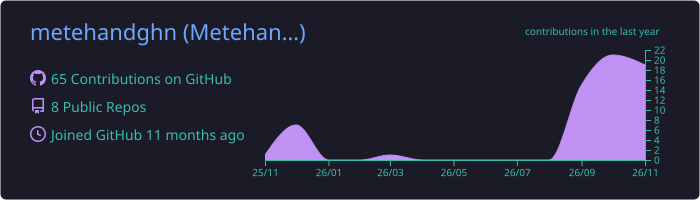
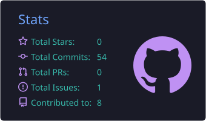
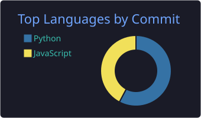

<!-- ═══════════════════════════ HEADER ═══════════════════════════ -->
<p align="center">
  
</p>

<p align="center">
  <a href="https://github.com/metehandghn">
    
  </a>
</p>

<p align="center">
  
  
  
  
</p>

---

## 👋 About Me

<table>
<tr>
<td width="58%" valign="top">

I'm **Metehan**, an **Information Systems and Technologies** student and a full stack developer from **Antalya, Türkiye**.

I like taking an idea all the way from a blank page to a **live product with a real domain** — designing the UI, writing the backend, modelling the database, deploying it and then promoting it. Most of what I build runs on **serverless edge infrastructure** (Cloudflare Workers + D1), so it stays fast and cheap to operate.

Beyond the web, I build **Windows desktop apps** and **browser extensions**, because I enjoy solving everyday problems wherever they live.

- 🚀 Currently shipping: **ÖnceBak**, **Kaynakça**, **Lidya Analiz**
- 🌱 Learning: system design, scalable backends, product growth
- 🤝 Open to: remote full stack roles, internships & collaborations
- ⚡ Fun fact: I host 6+ live sites with **zero server costs**

</td>
<td width="42%" valign="top">

```js
const metehan = {
  role:      "Full Stack Developer",
  education: "Information Systems & Tech.",
  location:  "Antalya, Türkiye 🇹🇷",

  frontend: ["HTML", "CSS", "JavaScript"],
  backend:  ["Python", "Node.js", "Workers"],
  data:     ["Cloudflare D1", "SQLite", "Firebase"],
  desktop:  ["Electron"],
  extras:   ["Chrome Extensions (MV3)"],

  motto: "Ship it, measure it, improve it.",
};
```

</td>
</tr>
</table>

---

## 🛠️ Tech Stack

<p align="center">
  <br/>
  
</p>

---

## 🌐 Live Products

> Real projects, real domains, running in production right now.

<table>
<tr>
<td width="50%" valign="top">

### 🚗 [ÖnceBak](https://oncebak.com.tr)
**Know a car's chronic problems before you buy it.**
A Turkish car database covering models, engines, known chronic issues and a pre-purchase checklist.


</td>
<td width="50%" valign="top">

### 📰 [Kaynakça](https://kaynakcahaber.com)
**One story, many sources — compared side by side.**
A news aggregator that shows how different outlets cover the same event, with Türkiye/World and category filters.


</td>
</tr>
<tr>
<td width="50%" valign="top">

### 📈 [Lidya Analiz](https://lidyaanaliz.formulfit.workers.dev)
**Stock analysis dashboard for BIST & US markets.**
Technical indicators, backtesting, strategy optimisation and fundamental data (P/E, gross profit…) in one panel.


</td>
<td width="50%" valign="top">

### 💪 [Formül](https://formul-planlayici.formulfit.workers.dev)
**Personal training & supplement planner.**
Workout programs by muscle group, protein/creatine/gainer dosing by body weight and calorie calculation — with login and a membership system.


</td>
</tr>
<tr>
<td colspan="2" valign="top">

### 📖 [Destan Kitabım](https://destan-kitabim.webprojeleri.workers.dev)
**Turkish epics and legends, retold as illustrated audiobooks for kids (ages 4–10).**
Storybook-style pages with character illustrations and natural, human-like AI narration.


</td>
</tr>
</table>

---

## 🧩 Open Source

| Project | What it does | Built with |
|---|---|---|
| 🦔 **[Kirpi — Güvenli Tarama](https://github.com/metehandghn/kirpi-guvenli-tarama)** | Browser security extension that blocks malicious redirects, forced downloads, crypto-miners and fake e-Devlet / bank / cargo phishing pages | Chrome & Edge · Manifest V3 · MIT |
| 🗂️ **[Masaüstü Düzenleyici](https://github.com/metehandghn/masaustu-duzenleyici)** | Windows app that groups desktop files by type and similar names, then turns the chosen groups into folders | Electron · Windows installer |
| ⚙️ **İşlemci Temizleyici** *(in progress)* | Windows app that detects and closes or throttles CPU/RAM-hungry apps, with profiles and history reports | Windows desktop |

---

## 📊 GitHub Analytics

<!-- Cards below are generated by .github/workflows/snake.yml (summary job) -->
<p align="center">
  
</p>

<p align="center">
  
  
</p>

<p align="center">
  
</p>

<!-- Snake animation: works after adding .github/workflows/snake.yml (see setup notes) -->
<p align="center">
  <picture>
    <source media="(prefers-color-scheme: dark)" srcset="https://raw.githubusercontent.com/metehandghn/metehandghn/output/github-snake-dark.svg" />
    
  </picture>
</p>

---

## 🤝 Let's Connect

<p align="center">
  <a href="https://www.linkedin.com/in/metehan-da%C4%9Fhan-09708a445/"></a>
  <a href="https://www.instagram.com/kodluyoo/"></a>
  <a href="https://github.com/metehandghn"></a>
</p>

<p align="center">
  
</p>
